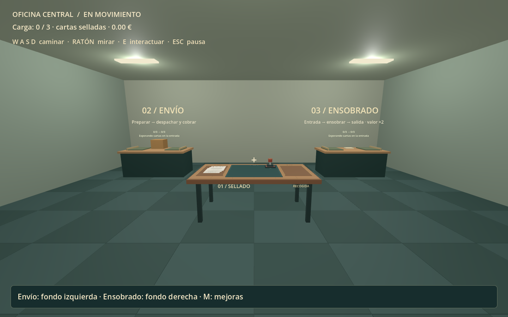
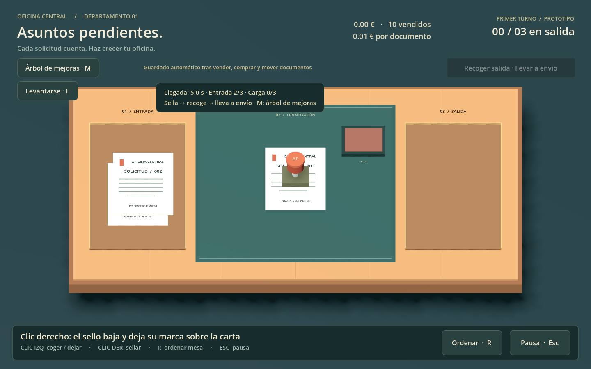

# Asuntos pendientes

Versión de prueba v0.4.0 · 6 de noviembre de 2026 · Godot 4.7.2 stable.

## Descargar y jugar en Windows

1. Abre [la última versión](https://github.com/EloiEstebanell/juego-incremental/releases/latest).
2. Descarga **Asuntos-pendientes-Windows-v0.4.0.zip**, extrae todo y abre **Jugar.cmd**.
3. El primer inicio prepara los recursos. No necesitas instalar Godot.

El ZIP de Code → Download ZIP contiene el código fuente sin motor; para usarlo, importa project.godot con Godot 4.7.2 estándar. Windows de 64 bits, renderizador Compatibility.

[Ver las 13 capturas](docs/galeria) · [Informar de un problema](https://github.com/EloiEstebanell/juego-incremental/issues)

## Las tres estaciones

1. **Sellado**, disponible al empezar. Clic izquierdo para coger el sello; clic derecho para sellar. El papel entra al centro y sale automáticamente. Las cartas nuevas llegan cada 5 segundos si queda espacio. Deja el sello y pulsa Recoger salida, o recoge en el frente derecho de la mesa con E.
2. **Envío**, disponible al empezar, al fondo a la izquierda. E abre el puesto. Deposita cartas, prepara cada envío y pulsa Despachar salida y cobrar. La preparación conserva el material; solo el despacho paga. Admite cartas selladas y sobres.
3. **Ensobrado**, al fondo a la derecha. Se compra en el árbol tras 10 ventas por 0,15 €. Deposita cartas selladas, ensobra y recoge los sobres de la salida. Llévalos a envío: valen el doble. No se puede ensobrar una carta dos veces.

Todas las estaciones tienen entrada y salida limitadas, inicialmente 3 plazas cada una. Se mejoran por separado. Si una salida se llena, su operario espera. Depositar o recoger transfiere solo lo que cabe y conserva el sobrante. Los repartidores reservan espacio de destino antes de recoger.

## Controles

- E: levantarse, sentarse o abrir/cerrar el puesto cercano.
- W A S D y ratón: caminar y mirar. Rodea la mesa por los pasillos laterales.
- M: abrir el árbol de mejoras desde la mesa o caminando. Deja primero cualquier objeto cogido.
- Esc: cerrar un panel o pausar. El árbol pausa toda la oficina; el panel de una estación permite que el trabajo continúe.
- R: ordenar la mesa conservando los documentos. No genera cartas ni vende nada.

La capacidad de mano comienza en 3 y aumenta de 2 en 2. Puedes completar una carga del mismo tipo, pero no mezclar cartas selladas con sobres. El número del HUD es la cantidad real; la pila visible representa hasta tres piezas.

## Árbol de mejoras

25 nodos en ocho ramas: Llegadas, Almacenes, Transporte, Valor, Sellado, Ensobrado, Envío y Rutas. Usa los botones superiores para saltar de rama y las barras para desplazarte. Las flechas y los textos indican los requisitos; cada ficha muestra efecto, nivel, precio y motivo de bloqueo.

Las mejoras iniciales de recepción, bandejas, carga, movimiento y valor son paralelas. Las contrataciones tienen hitos distintos:

| Desbloqueo | Ventas mínimas | Coste inicial |
| --- | ---: | ---: |
| Expedidor | 8 | 0,18 € |
| Ensobrado | 10 | 0,15 € |
| Repartidor sello → envío | 12 | 0,16 € |
| Sellador | 15 | 0,22 € |
| Repartidor sello → sobres | 20 + estación | 0,25 € |
| Ensobrador | 25 + estación | 0,30 € |
| Repartidor sobres → envío | 30 + estación | 0,25 € |

El sellador espera mientras tienes un objeto cogido. El ensobrador procesa la entrada y el expedidor prepara cartas y despacha cada 4 segundos. Los tres transportistas se contratan aparte. Cuando ambas rutas desde sellado están activas, se prioriza ensobrado si tiene hueco; la ruta directa puede pausarse en el panel de envío. Un viaje iniciado se completa aunque pauses esa ruta.

La práctica del sellador se compra después de contratarlo. Cualquier transportista contratado habilita las mejoras de velocidad y carga de repartidores. La velocidad manual de ensobrado y preparación también puede comprarse sin contratar su operario. Las mejoras se aplican a tareas/viajes nuevos, sin alterar uno que ya está en curso.

Los precios y umbrales son una primera propuesta de equilibrio. El pago se calcula con el valor vigente al despachar. No hay salarios recurrentes ni producción sin conexión.

## Guardado

Esquema **3**, en saves/progress.json, con respaldo .bak. Las versiones 1 y 2 conservan saldo, mejoras, papeles y carga al migrar. Las cartas ensobradas antiguas mantienen su valor aunque aún no hayas comprado el puesto.

Se guardan entradas, salidas, carga en manos, temporizadores y repartidores con su carga y reservas. Las tareas conservan el documento en entrada hasta completarse. El movimiento sobre la mesa se resuelve a su destino reservado. Se guarda en cada operación económica o de material y cada 5 segundos para actualizar tiempos. Al volver apareces sentado.

Una escritura fallida revierte la transferencia o venta afectada. Las partidas incompatibles no se sobrescriben. Nueva partida pide confirmación y conserva copia. Evita ejecutar dos instancias usando la misma partida: no hay coordinación entre procesos.

## Desarrollo

scripts/office/station_network.gd coordina estaciones, rutas e interfaz. station_state.gd define/valida el estado persistente. upgrade_tree.gd presenta el catálogo Resource; resources/upgrades contiene los 25 nodos. docs/MEJORAS.md documenta sus efectos.

Pruebas: tests/run_tests.gd, economy_tests.gd, office_tests.gd y station_tests.gd. Ejecutar con runtime/Godot.exe --headless --path . --script res://tests/NOMBRE.gd. Todas usan partidas aisladas en tests/.tmp. Detalles en docs/PRUEBAS.md.

Geometría y personajes provisionales; aún faltan arte, sonido, animación de empleados, ajustes de sensibilidad, exportación optimizada y valoración externa del equilibrio. Los repartidores siguen rutas fijas, sin navegación dinámica ni colisión con el jugador.

Repositorio: https://github.com/EloiEstebanell/juego-incremental
Versión pública: https://github.com/EloiEstebanell/juego-incremental/releases/tag/v0.4.0

## Capturas y proporciones

Abrir docs/galeria/index.html para recorrer 13 capturas reales. Las imágenes originales están en esa misma carpeta; El archivo Capturas-oficina.zip de Releases reúne la galería y los PNG. Mesa de sellado ajustada a 2,04 × 1,12 m y unos 77 cm de altura, con colisiones y rutas adaptadas. La vista sentada sigue siendo un primer plano para trabajar con precisión.

Godot y sus componentes conservan sus licencias originales; el paquete Windows incluye GODOT-NOTICES.txt. Este repositorio no otorga una licencia adicional de reutilización del código y recursos propios del juego.
