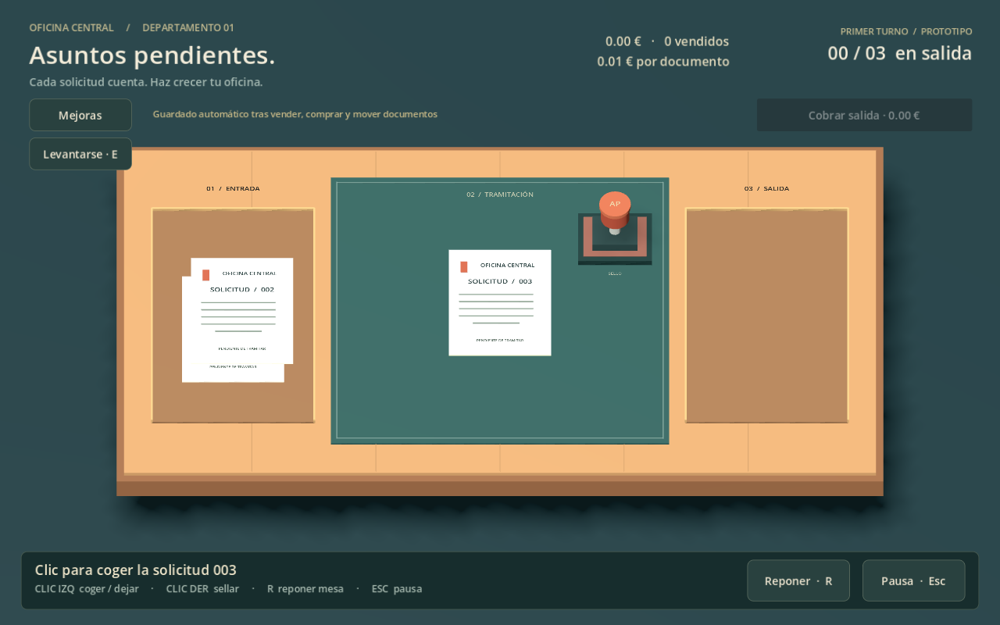
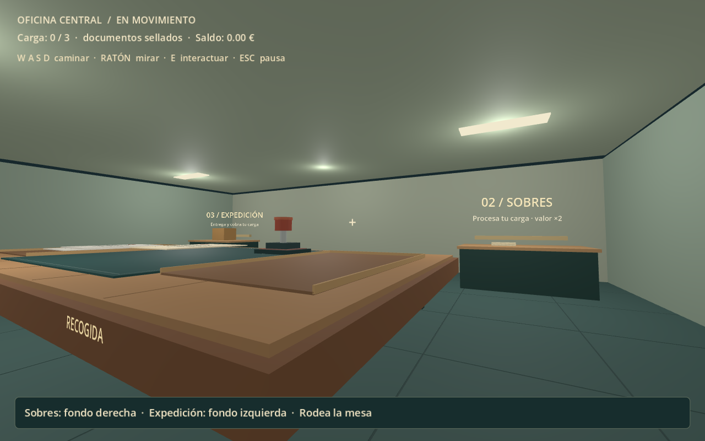

# Asuntos pendientes

Prototipo de juego incremental de oficina en 3D, creado con Godot 4.7.2. Empieza sellando documentos y reinvierte tus ingresos en mejoras.

## Descargar y jugar en Windows

1. Abre [la última versión de prueba](https://github.com/EloiEstebanell/juego-incremental/releases/latest).
2. Descarga **Asuntos-pendientes-Windows-v0.3.0.zip** de la sección Assets.
3. Extrae todo el ZIP en una carpeta donde puedas guardar archivos, por ejemplo en Documentos.
4. Abre **Jugar.cmd**. El primer inicio prepara los recursos y puede tardar unos segundos.

No necesitas instalar Godot. El paquete incluye el motor. El ZIP de **Code → Download ZIP** contiene solo el código fuente y no incluye el motor.

Prototipo para Windows de 64 bits, probado con OpenGL Compatibility en una NVIDIA GTX 1060 Max-Q. Todavía no se ha probado en otros equipos. No abras dos instancias a la vez.

## Cómo jugar

- El papel llega automáticamente al centro. Coge el sello con **clic izquierdo** y sella con **clic derecho**. El documento va solo a la salida y llega el siguiente.
- Deja el sello y pulsa **Cobrar salida**, o lleva la carga a sobres para aumentar su valor.
- **E**: levantarte, sentarte o interactuar con el puesto cercano.
- **WASD + ratón**: caminar y mirar. **Esc**: pausa.
- **Recogida**, en el frente derecho de la mesa: E recoge hasta tres documentos.
- **Sobres**, al fondo a la derecha: E ensobra la carga. **Expedición**, al fondo a la izquierda: E vende; los sobres pagan el doble.
- **Mejoras**: papel de más valor, multiplicador del sello, golpe más rápido y Tramitación ágil, que aumenta un 40 % la velocidad de los papeles por nivel. Desplaza la lista para ver las cuatro.
- **R** repone la mesa: descarta trabajo sin vender y conserva dinero, mejoras y carga.

## Guardado

Se guarda automáticamente en **saves/progress.json**, junto al juego. Incluye dinero, mejoras, papeles y carga transportada. Se conserva una copia anterior en progress.json.bak. Las partidas anteriores del esquema 1 son compatibles con el esquema 2 actual.

Para actualizar, conserva la carpeta saves y copia su contenido a la nueva versión. No compartas esa carpeta al informar de errores salvo que quieras adjuntar tu partida. No se guarda la posición del jugador: al cargar vuelves a la mesa con tu carga conservada. Un traslado en curso se resuelve a su destino; el ensobrado interrumpido debe repetirse.

## Informar de un problema

Abre una [incidencia](https://github.com/EloiEstebanell/juego-incremental/issues) indicando qué hiciste, qué ocurrió y tu versión de Windows. Si puedes, añade una captura. También interesan observaciones sobre controles, ritmo y claridad de las mejoras.

## Abrir el código fuente

Instala Godot **4.7.2 estándar**, importa project.godot y ejecuta la escena principal. Renderizador: Compatibility. No necesita complementos ni recursos externos.

Las mejoras se definen mediante Resource y archivos .tres. Consulta [la guía de mejoras](docs/MEJORAS.md). Las comprobaciones están en tests: 35 de mesa, 40 de economía y 44 de oficina. Ejecuta cada script con Godot --headless --path . --script res://tests/NOMBRE.gd después de importar el proyecto.

## Estado del prototipo

Incluye mesa automática, oficina explorable, sobres, economía, cuatro mejoras y guardado. El arte es provisional. Aún no hay empleados, sonido, sensibilidad configurable ni una campaña completa. Esta es una versión de prueba, no una demo comercial terminada.

Godot y sus componentes conservan sus licencias originales; el paquete Windows contiene GODOT-NOTICES.txt. Este repositorio no otorga una licencia adicional de reutilización del código y los recursos propios del juego.
